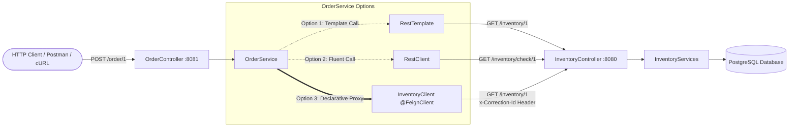

# 🛒 E-Commerce Microservices: Inter-Service HTTP Communication Guide

This project demonstrates and contrasts the three primary synchronous inter-service HTTP communication mechanisms in the Spring ecosystem:
1. **`RestTemplate`** (Classic Spring Web client)
2. **`RestClient`** (Modern fluent client introduced in Spring 6 / Spring Boot 3)
3. **`OpenFeign` (`@FeignClient`)** (Declarative REST client in Spring Cloud)

---

## 📑 Table of Contents
- [Architecture Overview](#-architecture-overview)
- [Core Communication Mechanisms](#-core-communication-mechanisms)
  - [1. RestTemplate](#1-resttemplate)
  - [2. RestClient](#2-restclient)
  - [3. FeignClient (Spring Cloud OpenFeign)](#3-feignclient-spring-cloud-openfeign)
- [Project Structure](#-project-structure)
- [File-by-File Breakdown & Code Explanation](#-file-by-file-breakdown--code-explanation)
  - [1. RestTemplateConfig.java](#1-resttemplateconfigjava)
  - [2. FeginConfig.java](#2-feginconfigjava)
  - [3. InventoryFeginClient.java](#3-inventoryfeginclientjava)
  - [4. InventoryClient.java](#4-inventoryclientjava)
  - [5. EcomOrderServiseApplication.java](#5-ecomorderserviseapplicationjava)
  - [6. OrderService.java](#6-orderservicejava)
  - [7. OrderController.java](#7-ordercontrollerjava)
  - [8. application.properties (Order Service)](#8-applicationproperties-order-service)
  - [9. pom.xml (Dependencies & Spring Cloud BOM)](#9-pomxml-dependencies--spring-cloud-bom)
  - [10. InventoryController.java (Inventory Service Provider)](#10-inventorycontrollerjava-inventory-service-provider)
- [Comparison Matrix: RestTemplate vs RestClient vs FeignClient](#-comparison-matrix-resttemplate-vs-restclient-vs-feignclient)
- [When to Use and Where to Use: Decision Guide](#-when-to-use-and-where-to-use-decision-guide)
- [Step-by-Step Execution & Testing Demonstration](#-step-by-step-execution--testing-demonstration)
  - [1. Prerequisites](#1-prerequisites)
  - [2. Starting the Inventory Service](#2-starting-the-inventory-service)
  - [3. Starting the Order Service](#3-starting-the-order-service)
  - [4. Triggering Requests](#4-triggering-requests)
  - [5. Expected Log Output (Observability)](#5-expected-log-output-observability)

---

## 🏛 Architecture Overview

The system consists of two microservices:

1. **`ecom-inventory-servise`** (Port: `8080`)
   - Manages stock levels in a PostgreSQL database (`ecom_product_database`).
   - Exposes REST endpoints to query inventory by `productId`, check stock availability, and update inventory count.
2. **`ecom-order-servise`** (Port: `8081`)
   - Exposes an order placement endpoint (`POST /order/{productId}`).
   - Communicates synchronously with `ecom-inventory-servise` to check stock availability and decrement quantity before confirming an order.



---

## 🔍 Core Communication Mechanisms

### 1. RestTemplate
- **Introduced**: Spring 3.0.
- **Style**: Imperative, template-pattern based (`getForObject`, `exchange`, `postForEntity`).
- **How it works**: Uses an underlying HTTP client (e.g., standard `HttpURLConnection`, Apache HttpClient, or OkHttp) wrapped in template helper methods that convert Java objects to/from HTTP requests/responses via `HttpMessageConverter`.
- **Status in Modern Spring**: As of Spring Framework 5.0, `RestTemplate` is in **maintenance mode**. No major new features are added. For synchronous requests in Spring 6+, **`RestClient`** is the officially recommended replacement.

### 2. RestClient
- **Introduced**: Spring Framework 6.1 / Spring Boot 3.2.
- **Style**: Synchronous, fluent, builder-style API (modeled after the reactive `WebClient` API, but without requiring Project Reactor / Netty).
- **How it works**: Provides a modern, readable method-chaining syntax (`get()`, `uri()`, `header()`, `retrieve()`, `body()`, `onStatus()`). It abstracts connection details and integrates directly with modern Spring HTTP message converters and custom error handlers without the boilerplate of `ResponseEntity` casting.

### 3. FeignClient (Spring Cloud OpenFeign)
- **Introduced**: Netflix Feign / Spring Cloud OpenFeign.
- **Style**: Declarative interface-driven proxy.
- **How it works**: You define a Java interface and annotate it with `@FeignClient`. At application startup, Spring Cloud generates a dynamic runtime proxy implementing that interface. Method parameters and annotations (`@GetMapping`, `@PathVariable`, `@RequestBody`) are automatically translated into outgoing HTTP requests.
- **Ecosystem**: Easily integrates with Spring Cloud LoadBalancer, Eureka discovery, Resilience4j circuit breakers, retries, and interceptors.

---

## 📂 Project Structure

```text
ecommerces/
├── ecom-inventory-servise/
│   ├── src/main/java/com/techtricks/ecom_inventory_servise/
│   │   ├── EcomInventoryServiseApplication.java
│   │   ├── controller/
│   │   │   └── InventoryController.java         # Exposes GET/POST/PUT inventory endpoints
│   │   ├── dao/
│   │   │   └── InventoryRepository.java         # Spring Data JPA Repository
│   │   ├── model/
│   │   │   └── Inventory.java                   # JPA Entity (productId, quantity)
│   │   └── services/
│   │       └── InventoryServices.java           # Business logic & DB transactions
│   └── src/main/resources/
│       └── application.properties               # Port 8080, PostgreSQL & JPA settings
│
├── ecom-order-servise/
│   ├── src/main/java/com/techtricks/ecom_order_servise/
│   │   ├── EcomOrderServiseApplication.java     # @EnableFeignClients
│   │   ├── InventoryDTO.java                    # Data Transfer Object for inventory data
│   │   ├── client/
│   │   │   └── InventoryClient.java             # Feign declarative client interface
│   │   ├── config/
│   │   │   ├── RestTemplateConfig.java          # RestTemplate and RestClient Bean definitions
│   │   │   ├── FeginConfig.java                 # Global Feign Logger level bean
│   │   │   └── InventoryFeginClient.java        # Feign config: timeouts, retries, interceptor
│   │   ├── controller/
│   │   │   └── OrderController.java             # Exposes POST /order/{productId}
│   │   └── services/
│   │       └── OrderService.java                # Demonstrates RestTemplate, RestClient, FeignClient
│   └── src/main/resources/
│       └── application.properties               # Port 8081, Feign debug logging
└── README.md
```

---

## 🔬 File-by-File Breakdown & Code Explanation

### 1. `RestTemplateConfig.java`
**Path**: `ecom-order-servise/src/main/java/com/techtricks/ecom_order_servise/config/RestTemplateConfig.java`

```java
package com.techtricks.ecom_order_servise.config;

import org.springframework.context.annotation.Bean;
import org.springframework.context.annotation.Configuration;
import org.springframework.web.client.RestClient;
import org.springframework.web.client.RestTemplate;

@Configuration
public class RestTemplateConfig {

    @Bean
    public RestTemplate restTemplate() {
        return new RestTemplate();
    }

    @Bean
    public RestClient restClient() {
        return RestClient.create();
    }
}
```

#### Detailed Explanation:
- **`@Configuration`**: Marks this class as a source of Spring bean definitions managed by the Spring IoC container.
- **`restTemplate()` Bean**:
  - Instantiates a standard `RestTemplate` singleton bean.
  - Allows injecting `RestTemplate` into any service via constructor injection.
- **`restClient()` Bean**:
  - Uses `RestClient.create()` to create a default instance of the Spring 6 `RestClient`.
  - Can also be customized with base URLs, default headers, and connection request factories using `RestClient.builder()`.

---

### 2. `FeginConfig.java`
**Path**: `ecom-order-servise/src/main/java/com/techtricks/ecom_order_servise/config/FeginConfig.java`

```java
package com.techtricks.ecom_order_servise.config;

import org.springframework.context.annotation.Bean;
import org.springframework.context.annotation.Configuration;
import feign.Logger;

@Configuration
public class FeginConfig {

    @Bean
    public Logger.Level feginLoggerLevel() {
        return Logger.Level.FULL;
    }
}
```

#### Detailed Explanation:
- **`Logger.Level.FULL`**: Feign provides four logging levels:
  - `NONE`: No logging (default).
  - `BASIC`: Logs only request method, URL, response status code, and execution time.
  - `HEADERS`: Logs basic information plus request and response headers.
  - `FULL`: Logs headers, request body, response body, and metadata for both requests and responses.
- Having this bean outputs detailed HTTP traffic in console when Feign debug logging is enabled.

---

### 3. `InventoryFeginClient.java`
**Path**: `ecom-order-servise/src/main/java/com/techtricks/ecom_order_servise/config/InventoryFeginClient.java`

```java
package com.techtricks.ecom_order_servise.config;

import java.time.Duration;
import java.util.UUID;
import org.springframework.context.annotation.Bean;
import org.springframework.context.annotation.Configuration;
import feign.Logger;
import feign.Request;
import feign.RequestInterceptor;
import feign.Retryer;

@Configuration
public class InventoryFeginClient {

    @Bean
    public Logger.Level feginInvLoggerLevel() {
        return Logger.Level.FULL;
    }

    @Bean
    public Request.Options options() {
        return new Request.Options(Duration.ofMillis(3000), Duration.ofMillis(5000), true);
    }

    @Bean
    public Retryer retryer() {
        return new Retryer.Default(1L, 2L, 3);
    }

    @Bean
    public RequestInterceptor requestInterceptor() {
        return requestTemplate -> {
            requestTemplate.header("x-Correction-Id", UUID.randomUUID().toString());
        };
    }
}
```

#### Detailed Explanation:
This class provides client-specific resilience and telemetry configuration for the inventory Feign client:
1. **`Request.Options options()`**:
   - `connectTimeout = 3000ms` (3 seconds): Maximum time allowed to establish the TCP connection to the inventory service.
   - `readTimeout = 5000ms` (5 seconds): Maximum time waiting for data after the connection is established.
   - `followRedirects = true`: Automatically follows 3xx HTTP redirects.
2. **`Retryer retryer()`**:
   - `new Retryer.Default(period = 1ms, maxPeriod = 2ms, maxAttempts = 3)`: Configures exponential backoff retries. If a network issue or retryable exception occurs, Feign automatically retries up to 3 times before failing.
3. **`RequestInterceptor requestInterceptor()`**:
   - Feign interceptors execute on every outgoing request before it hits the network.
   - **Distributed Tracing / Correlation ID**: Attaches an `x-Correction-Id` (Correlation ID) HTTP header generated using `UUID.randomUUID()`. When debugging downstream services, engineers can trace a single request across multiple microservice logs using this ID.

---

### 4. `InventoryClient.java`
**Path**: `ecom-order-servise/src/main/java/com/techtricks/ecom_order_servise/client/InventoryClient.java`

```java
package com.techtricks.ecom_order_servise.client;

import org.springframework.cloud.openfeign.FeignClient;
import org.springframework.web.bind.annotation.GetMapping;
import org.springframework.web.bind.annotation.PathVariable;
import org.springframework.web.bind.annotation.PostMapping;
import org.springframework.web.bind.annotation.RequestBody;
import com.techtricks.ecom_order_servise.InventoryDTO;
import com.techtricks.ecom_order_servise.config.InventoryFeginClient;

@FeignClient(
    name = "inventory-service", 
    url = "http://localhost:8080", 
    configuration = InventoryFeginClient.class
)
public interface InventoryClient {

    @GetMapping("/inventory/{productId}")
    public InventoryDTO getInventory(@PathVariable Long productId);

    @PostMapping("/inventory")
    public String updateInventory(@RequestBody InventoryDTO inventoryDTO);
}
```

#### Detailed Explanation:
- **`@FeignClient`**:
  - `name = "inventory-service"`: Logical identifier for the target service (used with Eureka service discovery or client-side load balancers).
  - `url = "http://localhost:8080"`: The explicit destination URL where `ecom-inventory-servise` is running.
  - `configuration = InventoryFeginClient.class`: Binds our custom timeouts, retries, correlation ID interceptor, and logger level specifically to this client.
- **`getInventory(...)`**:
  - Maps to `GET http://localhost:8080/inventory/{productId}`.
  - Spring automatically serializes `{productId}` into the path and deserializes the JSON response body into an `InventoryDTO` object.
- **`updateInventory(...)`**:
  - Maps to `POST http://localhost:8080/inventory`.
  - Serializes `InventoryDTO` into the JSON request body.

---

### 5. `EcomOrderServiseApplication.java`
**Path**: `ecom-order-servise/src/main/java/com/techtricks/ecom_order_servise/EcomOrderServiseApplication.java`

```java
package com.techtricks.ecom_order_servise;

import org.springframework.boot.SpringApplication;
import org.springframework.boot.autoconfigure.SpringBootApplication;
import org.springframework.cloud.openfeign.EnableFeignClients;

@SpringBootApplication
@EnableFeignClients
public class EcomOrderServiseApplication {

    public static void main(String[] args) {
        SpringApplication.run(EcomOrderServiseApplication.class, args);
    }
}
```

#### Detailed Explanation:
- **`@EnableFeignClients`**: Scans the project packages for interfaces declared with `@FeignClient`. Without this annotation on a `@Configuration` or `@SpringBootApplication` class, Spring Cloud OpenFeign will **not** register Feign client proxies as injectable Spring beans.

---

### 6. `OrderService.java`
**Path**: `ecom-order-servise/src/main/java/com/techtricks/ecom_order_servise/services/OrderService.java`

```java
package com.techtricks.ecom_order_servise.services;

import org.springframework.http.HttpStatusCode;
import org.springframework.http.ResponseEntity;
import org.springframework.stereotype.Service;
import org.springframework.web.client.RestClient;
import org.springframework.web.client.RestTemplate;
import com.techtricks.ecom_order_servise.InventoryDTO;
import com.techtricks.ecom_order_servise.client.InventoryClient;

@Service
public class OrderService {

    private final RestTemplate restTemplate;
    private final RestClient restClient;
    private final InventoryClient inventoryClient;

    public OrderService(RestTemplate restTemplate, RestClient restClient, InventoryClient inventoryClient) {
        this.restTemplate = restTemplate;
        this.restClient = restClient;
        this.inventoryClient = inventoryClient;
    }

    public String placeOrder(Long productId) {

        /*
         * ==========================================
         * 1. RestTemplate Implementation (Classic)
         * ==========================================
         */
        // String response = restTemplate.getForObject(
        //     "http://localhost:8080/inventory/" + productId,
        //     String.class);

        /*
         * ==========================================
         * 2. RestClient Implementation (Spring 6 Fluent)
         * ==========================================
         */
        // ResponseEntity<InventoryDTO> response = restClient.get()
        //     .uri("http://localhost:8080/inventory/check/{productId}", productId)
        //     .retrieve()
        //     .onStatus(HttpStatusCode::is4xxClientError, (request, response1) -> {
        //         throw new RuntimeException("Inventory not found");
        //     })
        //     .toEntity(InventoryDTO.class);
        //
        // updateInventory(response.getBody());
        // return response != null && response.getBody().getQuantity() > 0 ? "order Placed" : "Out Of Order";

        /*
         * ==========================================
         * 3. FeignClient Implementation (Declarative)
         * ==========================================
         */
        InventoryDTO inventory = inventoryClient.getInventory(productId);

        int quantity = inventory.getQuantity();
        updateInventory(inventory);

        return quantity != 0 ? "Order placed" : "Out of Stock";
    }

    private void updateInventory(InventoryDTO inventory) {
        inventory.setQuantity(inventory.getQuantity() - 1);

        // --- RestClient POST demonstration ---
        // restClient.post()
        //     .uri("http://localhost:8080/inventory")
        //     .body(inventory)
        //     .retrieve()
        //     .toBodilessEntity();

        // --- FeignClient POST demonstration ---
        inventoryClient.updateInventory(inventory);
    }
}
```

#### Detailed Explanation:
- Demonstrates **all three paradigms** in a single business flow:
  1. **`RestTemplate`**: Calls `getForObject(...)` with direct string URL concatenation. Returns raw response types or requires template response extractors.
  2. **`RestClient`**: Uses fluent chaining (`.get().uri(...).retrieve().onStatus(...).toEntity(...)`). It showcases declarative status code inspection (`.onStatus(HttpStatusCode::is4xxClientError, ...)`) without requiring verbose `try-catch` blocks or raw `HttpClientErrorException` catches.
  3. **`InventoryClient` (Feign)**: Completely decouples business code from URLs, HTTP protocols, headers, and serialization. The service simply calls `inventoryClient.getInventory(productId)` like a standard local Java method.

---

### 7. `OrderController.java`
**Path**: `ecom-order-servise/src/main/java/com/techtricks/ecom_order_servise/controller/OrderController.java`

```java
package com.techtricks.ecom_order_servise.controller;

import org.springframework.web.bind.annotation.PathVariable;
import org.springframework.web.bind.annotation.PostMapping;
import org.springframework.web.bind.annotation.RequestMapping;
import org.springframework.web.bind.annotation.RestController;
import com.techtricks.ecom_order_servise.services.OrderService;

@RestController
@RequestMapping("/order")
public class OrderController {

    private final OrderService orderService;

    public OrderController(OrderService orderService) {
        this.orderService = orderService;
    }

    @PostMapping("/{productId}")
    public String placeOrder(@PathVariable Long productId) {
        return orderService.placeOrder(productId);
    }
}
```

#### Detailed Explanation:
- Exposes `POST /order/{productId}` on port `8081`.
- When triggered, it delegates order execution to `orderService.placeOrder(productId)` which communicates with the inventory service.

---

### 8. `application.properties` (Order Service)
**Path**: `ecom-order-servise/src/main/resources/application.properties`

```properties
spring.application.name=ecom-order-servise

server.port=8081

# Enable Feign logs
logging.level.com.techtricks.ecom_order_servise.client=DEBUG
```

#### Detailed Explanation:
- `server.port=8081`: Runs on a dedicated port distinct from the inventory service (`8080`).
- `logging.level.com.techtricks.ecom_order_servise.client=DEBUG`: Feign clients log only at the **`DEBUG`** level. To see the output of `Logger.Level.FULL`, the logger package containing the Feign client interface (`com.techtricks.ecom_order_servise.client`) must be set to `DEBUG`.

---

### 9. `pom.xml` (Dependencies & Spring Cloud BOM)
**Path**: `ecom-order-servise/pom.xml`

```xml
<properties>
    <java.version>21</java.version>
    <spring-cloud.version>2025.1.2</spring-cloud.version>
</properties>

<dependencyManagement>
    <dependencies>
        <dependency>
            <groupId>org.springframework.cloud</groupId>
            <artifactId>spring-cloud-dependencies</artifactId>
            <version>${spring-cloud.version}</version>
            <type>pom</type>
            <scope>import</scope>
        </dependency>
    </dependencies>
</dependencyManagement>

<dependencies>
    <!-- Spring Web / MVC (Includes RestTemplate & RestClient) -->
    <dependency>
        <groupId>org.springframework.boot</groupId>
        <artifactId>spring-boot-starter-webmvc</artifactId>
    </dependency>

    <!-- Spring Cloud OpenFeign -->
    <dependency>
        <groupId>org.springframework.cloud</groupId>
        <artifactId>spring-cloud-starter-openfeign</artifactId>
    </dependency>
</dependencies>
```

#### Detailed Explanation:
- `spring-boot-starter-webmvc`: Provides both `RestTemplate` and `RestClient` out of the box in Spring Boot 3+. No extra dependencies are needed for them.
- `spring-cloud-starter-openfeign`: Provides Feign client proxy infrastructure, annotations, retryers, and interceptors.
- `spring-cloud-dependencies`: Bill of Materials (BOM) managing compatible versions of Spring Cloud modules matching the Spring Boot version.

---

### 10. `InventoryController.java` (Inventory Service Provider)
**Path**: `ecom-inventory-servise/src/main/java/com/techtricks/ecom_inventory_servise/controller/InventoryController.java`

```java
package com.techtricks.ecom_inventory_servise.controller;

import java.util.List;
import org.springframework.web.bind.annotation.*;
import com.techtricks.ecom_inventory_servise.model.Inventory;
import com.techtricks.ecom_inventory_servise.services.InventoryServices;

@RestController
@RequestMapping("/inventory")
public class InventoryController {

    private final InventoryServices inventoryServices;

    public InventoryController(InventoryServices inventoryServices) {
        this.inventoryServices = inventoryServices;
    }

    // POST /inventory: Add / Update inventory record
    @PostMapping
    public Inventory addInventory(@RequestBody Inventory inventory) {
        return inventoryServices.addInventory(inventory);
    }

    // GET /inventory: List all inventories
    @GetMapping
    public List<Inventory> getAllInventory() {
        return inventoryServices.getAllInventory();
    }

    // GET /inventory/{productId}: Fetch inventory for product
    @GetMapping("/{productId}")
    public Inventory getInventory(@PathVariable Long productId) throws InterruptedException {
        System.out.println("Inventory request for product id:" + productId);
        return inventoryServices.getInventory(productId);
    }

    // PUT /inventory/{productId}: Update quantity for specific product
    @PutMapping("/{productId}")
    public Inventory updateInventory(@PathVariable Long productId, @RequestBody Inventory inventory) {
        return inventoryServices.updateInventory(productId, inventory);
    }

    // GET /inventory/check/{productId}: Check stock status
    @GetMapping("/check/{productId}")
    public Inventory checkInventory(@PathVariable Long productId) {
        return inventoryServices.checkStock(productId);
    }
}
```

#### Detailed Explanation:
- Acts as the HTTP service provider running on `http://localhost:8080`.
- Receives calls issued by `OrderService` (via Feign, RestClient, or RestTemplate).
- Outputs confirmation logs (e.g., `"Inventory request for product id:1"`) to verify inter-service communication.

---

## 📊 Comparison Matrix: RestTemplate vs RestClient vs FeignClient

| Feature / Criteria | `RestTemplate` | `RestClient` | `FeignClient` (OpenFeign) |
| :--- | :--- | :--- | :--- |
| **Introduced In** | Spring 3.0 | Spring Framework 6.1 / Spring Boot 3.2 | Netflix / Spring Cloud |
| **API Paradigm** | Imperative Template Method Pattern | Fluent, Method-Chaining Synchronous Builder | Declarative Interface + Runtime Proxy |
| **Code Style** | `restTemplate.getForObject(url, Class)` | `restClient.get().uri(...).retrieve()` | Java interface annotated with `@GetMapping` |
| **Spring Cloud Required?** | ❌ No | ❌ No | ✅ Yes (`spring-cloud-starter-openfeign`) |
| **Current Status** | ⚠️ **Maintenance Mode** | 🚀 **Modern Recommended Standard** | 🛡️ **Active Spring Cloud Standard** |
| **Error Handling** | `ResponseErrorHandler` or `try/catch` on `RestClientException` | Built-in `.onStatus(predicate, handler)` | Custom `ErrorDecoder` bean |
| **Interceptors & Headers** | `ClientHttpRequestInterceptor` | `ClientHttpRequestInterceptor` or `.defaultHeader()` | `RequestInterceptor` |
| **Timeouts & Retries** | Requires custom `ClientHttpRequestFactory` config | Configured via underlying `ClientHttpRequestFactory` | First-class beans: `Request.Options`, `Retryer` |
| **URL Management** | Manual string formatting or URI templates | Fluent URI templates with path variable replacement | Declarative path variables in interface methods |
| **Service Discovery Support** | Can be `@LoadBalanced` | Can be `@LoadBalanced` | Native integration with Eureka, Consul, etc. |
| **Unit Test Mocking** | `MockRestServiceServer` | `MockRestServiceServer` | Easy interface mocking via Mockito (`@MockBean`) |

---

## 🧭 When to Use and Where to Use: Decision Guide

### 1. When to use `RestTemplate`
* **Legacy Projects**: Existing codebases running on Spring Boot 2.x or older.
* **Maintenance Only**: Bug fixes or small tweaks in legacy services where refactoring is not budgeted.
* ❌ **Do NOT use for new projects**: Spring officially recommends against starting new implementations with `RestTemplate`.

### 2. When to use `RestClient`
* **Modern Standalone Spring Boot Applications**: Any service running on Spring Boot 3.2+ that does not need the full Spring Cloud dependency suite.
* **Ad-Hoc / Dynamic Requests**: When endpoints, request headers, query parameters, or HTTP methods change dynamically at runtime and cannot be neatly represented as static interface contracts.
* **Consuming External 3rd-Party APIs**: Integrations with Stripe, SendGrid, Twilio, or PayPal where you want a clean, fluent HTTP client without introducing Spring Cloud dependencies.
* **Microservices without Eureka/Spring Cloud**: Lightweight microservice deployments (e.g., inside Kubernetes where K8s Services handle DNS and load balancing).

### 3. When to use `FeignClient` (OpenFeign)
* **Spring Cloud Microservice Ecosystems**: When using Spring Cloud features such as Service Discovery (Eureka), Cloud Config, Gateway, or Resilience4j.
* **Strict Inter-Service API Contracts**: When microservices share API interfaces via client libraries (SDKs / contract JARs).
* **Enterprise Features Built-in**:
  - Declarative authentication/correlation propagation across services using `RequestInterceptor`.
  - Configurable timeouts and automatic retries (`Retryer.Default`).
  - Seamless declarative fallback methods with Resilience4j/Circuit Breakers.

### Summary Flowchart: Which Client Should You Pick?

```text
Do you already use Spring Cloud (Eureka / Service Discovery / Spring Cloud Gateway)?
   │
   ├── YES ──► Use OpenFeign (@FeignClient)
   │           (Clean declarative contracts, built-in load balancing & interceptors)
   │
   └── NO ──► Are you using Spring Boot 3.2+ / Spring 6+?
                 │
                 ├── YES ──► Use RestClient
                 │           (Modern, fluent synchronous client, zero extra dependencies)
                 │
                 └── NO (Legacy Spring 5 / Boot 2) ──► RestTemplate (or WebClient)
```

---

## 🚀 Step-by-Step Execution & Testing Demonstration

### 1. Prerequisites
- **Java 21** or later installed (`java -version`).
- **Maven** installed (`mvn -version`).
- **PostgreSQL** installed and running on port `5432`.
- Database `ecom_product_database` created:
  ```sql
  CREATE DATABASE ecom_product_database;
  ```

---

### 2. Starting the Inventory Service
Open a terminal in `ecom-inventory-servise`:
```powershell
cd c:\Users\naras\OneDrive\Documents\ecommerces\ecom-inventory-servise
mvn spring-boot:run
```
The service will boot on **port `8080`**.

Add initial inventory data:
```bash
curl -X POST http://localhost:8080/inventory \
  -H "Content-Type: application/json" \
  -d "{\"productId\": 1, \"quantity\": 10}"
```

Check the stored inventory:
```bash
curl http://localhost:8080/inventory/1
```
*Expected Response:*
```json
{"productId":1,"quantity":10}
```

---

### 3. Starting the Order Service
Open a second terminal in `ecom-order-servise`:
```powershell
cd c:\Users\naras\OneDrive\Documents\ecommerces\ecom-order-servise
mvn spring-boot:run
```
The service will boot on **port `8081`**.

---

### 4. Triggering Requests
Place an order for Product ID `1`:
```bash
curl -X POST http://localhost:8081/order/1
```

*Expected Response:*
```text
Order placed
```

Place multiple orders until stock reaches `0`:
```bash
curl -X POST http://localhost:8081/order/1
```
When quantity reaches zero, the response becomes:
```text
Out of Stock
```

---

### 5. Expected Log Output (Observability)

Because `InventoryFeginClient.java` defines `Logger.Level.FULL` and `application.properties` sets `logging.level.com.techtricks.ecom_order_servise.client=DEBUG`, you will see full Feign HTTP traces in the `ecom-order-servise` console:

```log
2026-10-20T15:53:41.950+05:30 DEBUG 13032 --- [nio-8081-exec-1] c.t.e.client.InventoryClient : [InventoryClient#getInventory] ---> GET http://localhost:8080/inventory/1 HTTP/1.1
2026-10-20T15:53:41.950+05:30 DEBUG 13032 --- [nio-8081-exec-1] c.t.e.client.InventoryClient : [InventoryClient#getInventory] x-Correction-Id: c3b79f64-8c81-4b71-bdf1-30ef410a5628
2026-10-20T15:53:41.950+05:30 DEBUG 13032 --- [nio-8081-exec-1] c.t.e.client.InventoryClient : [InventoryClient#getInventory] ---> END HTTP (0-byte body)
2026-10-20T15:53:41.955+05:30 DEBUG 13032 --- [nio-8081-exec-1] c.t.e.client.InventoryClient : [InventoryClient#getInventory] <--- HTTP/1.1 200 (5ms)
2026-10-20T15:53:41.955+05:30 DEBUG 13032 --- [nio-8081-exec-1] c.t.e.client.InventoryClient : [InventoryClient#getInventory] {"productId":1,"quantity":10}
2026-10-20T15:53:41.955+05:30 DEBUG 13032 --- [nio-8081-exec-1] c.t.e.client.InventoryClient : [InventoryClient#getInventory] <--- END HTTP (30-byte body)

2026-10-20T15:53:41.957+05:30 DEBUG 13032 --- [nio-8081-exec-1] c.t.e.client.InventoryClient : [InventoryClient#updateInventory] ---> POST http://localhost:8080/inventory HTTP/1.1
2026-10-20T15:53:41.957+05:30 DEBUG 13032 --- [nio-8081-exec-1] c.t.e.client.InventoryClient : [InventoryClient#updateInventory] Content-Type: application/json
2026-10-20T15:53:41.957+05:30 DEBUG 13032 --- [nio-8081-exec-1] c.t.e.client.InventoryClient : [InventoryClient#updateInventory] x-Correction-Id: 7894a8e2-f672-4d2a-bc91-20a2e0a24d8f
2026-10-20T15:53:41.957+05:30 DEBUG 13032 --- [nio-8081-exec-1] c.t.e.client.InventoryClient : [InventoryClient#updateInventory] 
2026-10-20T15:53:41.957+05:30 DEBUG 13032 --- [nio-8081-exec-1] c.t.e.client.InventoryClient : [InventoryClient#updateInventory] {"productId":1,"quantity":9}
2026-10-20T15:53:41.957+05:30 DEBUG 13032 --- [nio-8081-exec-1] c.t.e.client.InventoryClient : [InventoryClient#updateInventory] ---> END HTTP (29-byte body)
```

In the `ecom-inventory-servise` console:
```log
Inventory request for product id:1
Hibernate: 
    select i1_0.product_id, i1_0.quantity from inventory i1_0 where i1_0.product_id=?
Hibernate: 
    update inventory set quantity=? where product_id=?
```

---

## 💡 Switching Implementations in `OrderService`

To test **`RestClient`** or **`RestTemplate`** instead of Feign:
1. Open [`OrderService.java`](file:///c:/Users/naras/OneDrive/Documents/ecommerces/ecom-order-servise/src/main/java/com/techtricks/ecom_order_servise/services/OrderService.java).
2. Uncomment the **`RestClient`** block or **`RestTemplate`** block inside `placeOrder(...)` and `updateInventory(...)`.
3. Comment out the `inventoryClient` calls.
4. Restart `ecom-order-servise` and re-test with cURL to observe the difference in execution!
